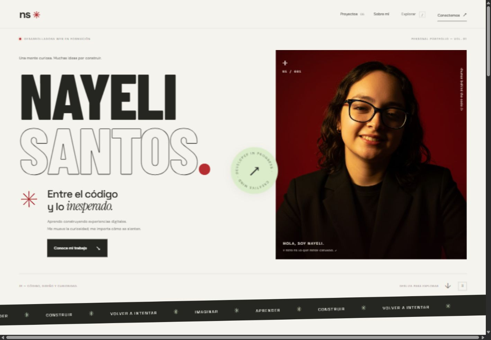

# Nayeli Santos · Portafolio

Portafolio personal de una desarrolladora web en formación. Diseño editorial con retrato, proyectos y galerías de capturas reales.

## Proyectos

- [Ritmo](https://github.com/NayeliSantos19/ritmo-study-app): seguimiento de estudio y enfoque.
- [StudySpot](https://github.com/NayeliSantos19/studyspot): espacios de estudio universitarios.
- [Bobinapp](https://github.com/NayeliSantos19/bobinapp): gestión de ganado bovino.
- [Comanda](https://github.com/NayeliSantos19/comanda) y [Filalista](https://github.com/NayeliSantos19/filalista): repositorios por completar o documentar.

## Vista previa

## Tecnologías e interacciones

HTML, CSS y JavaScript sin compilación. Galerías con miniaturas, navegación, ampliación y control por teclado; filtros de proyectos y explorador con la tecla /. Diseño adaptable y compatibilidad con movimiento reducido.

## Ejecutar

Descarga el repositorio y abre index.html en un navegador moderno, o sirve la carpeta con Live Server de Visual Studio Code. Todos los recursos del proyecto están en la raíz para facilitar la publicación con GitHub Pages.

## Notas sobre las capturas

Las imágenes de Bobinapp corresponden al prototipo web publicado en su repositorio, no a Android. La demo de StudySpot mostraba un error de conexión de datos el 15 de octubre de 2026; las capturas y sus leyendas conservan ese estado. Las fuentes de Google tienen alternativas del sistema.

## Proceso de aprendizaje

Proyecto desarrollado con asistencia de Codex. Forma parte de mi proceso de aprendizaje en estructura semántica, CSS adaptable, interacciones de JavaScript y publicación web.
